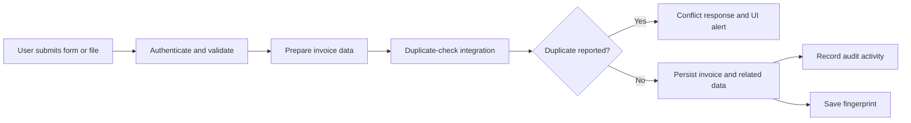
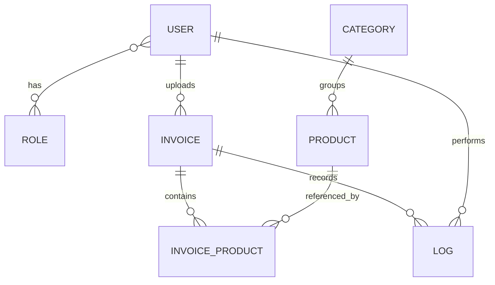

<div align="center">


# Invoice Tracker System

**Full-stack invoice management with role-based access, audit history, AI-assisted extraction, and duplicate detection.**

Developed as part of training with **Harri**.


[Overview](#overview) · [Architecture](#architecture) · [Quick Start](#quick-start) · [API Reference](#api-reference) · [Security](#security-and-production-readiness)

</div>

---

## Overview

Invoice Tracker brings invoice submission, product management, review, and traceability into one system. Users can submit structured invoices or upload documents; auditors can inspect records; administrators can manage users and catalog data.

The complete project consists of three applications:

| Application | Responsibility | Default local port |
|---|---|---|
| [`invoice-tracker-frontend`](https://github.com/WafaaAlshaikh/invoice-tracker-frontend) | React interface, dashboards, invoice forms, AI tools | `3000` |
| `invoicetracker` | Main REST API, authentication, invoice lifecycle, audit logs | `8080` |
| [`duplicate-check-service`](https://github.com/WafaaAlshaikh/duplicate-check-service) | Fingerprints, similarity analysis, duplicate-check API | `8081` |

> **Repository scope:** this repository contains the main backend at its root. The [React frontend](https://github.com/WafaaAlshaikh/invoice-tracker-frontend) and [duplicate-check service](https://github.com/WafaaAlshaikh/duplicate-check-service) are maintained in separate repositories. Download or clone both companion repositories to work with the complete system; cloning this repository alone provides only the main backend.
>
> The images below are documentation illustrations, not screenshots of a running application. Runtime behavior and external integrations have not been verified as part of this documentation update.

## Contents

- [Features](#features)
- [Architecture](#architecture)
- [Technology Stack](#technology-stack)
- [Roles and Permissions](#roles-and-permissions)
- [Quick Start](#quick-start)
- [Configuration](#configuration)
- [Using the Application](#using-the-application)
- [API Reference](#api-reference)
- [Request Examples](#request-examples)
- [Data Model](#data-model)
- [Project Structure](#project-structure)
- [Testing and Builds](#testing-and-builds)
- [Docker Notes](#docker-notes)
- [Security and Production Readiness](#security-and-production-readiness)
- [Troubleshooting](#troubleshooting)
- [Contributing](#contributing)
- [Acknowledgments and License](#acknowledgments-and-license)

## Features

### Invoice management

- Create invoices using JSON form data or multipart file uploads.
- Upload PDF, JPEG, PNG, and GIF files.
- Associate products and quantities with invoice records.
- View, update, download, and delete invoices subject to ownership and role checks.
- Search and filter by text, date range, file type, and status.
- Browse paginated results and invoice statistics.
- Track statuses: `PENDING`, `APPROVED`, `REJECTED`, and `COMPLETED`.
- Record invoice activity with audit entries and before/after state data where captured.

### Users and catalog

- Register and sign in with JWT-based authentication.
- Manage users, roles, account status, and passwords.
- Organize products into categories.
- Use role-aware navigation for regular users, auditors, and administrators.

### AI-assisted tools

- Extract structured invoice information from uploaded documents through Google Gemini.
- Ask natural-language questions about invoice data through the AI chatbot.
- Review extracted information before relying on it: AI output may be incomplete or incorrect.
- AI extraction has a **4 MB** service-level file limit, separate from the normal **10 MB** invoice-upload limit.

### Duplicate detection

- A separate service stores invoice fingerprints and evaluates potential matches.
- Matching logic uses invoice metadata, text/hash comparisons, and similarity scoring, with optional AI-assisted checks.
- The frontend includes duplicate-alert handling for conflict responses.
- PDF text extraction uses PDFBox; additional parsing uses Tika.

> Duplicate detection is advisory logic, not a guarantee that every duplicate will be found. The main backend includes error fallbacks when the service is unavailable. Image parsing through Tika is not equivalent to a configured OCR engine.

## Architecture


The main backend follows a layered design:

1. **Controllers and DTOs** define HTTP routes, input contracts, and response models.
2. **Security components** authenticate JWTs and apply route/method authorization.
3. **Services** implement business rules, ownership checks, and audit operations.
4. **Factories and strategies** separate invoice creation and file-processing paths.
5. **Repositories and entities** persist data through Spring Data JPA.

### Typical submission flow



External-service failures follow the current implementation's fallback behavior; they are not represented as a strict rejection path in this simplified diagram.

## Technology Stack

| Layer | Technologies |
|---|---|
| Frontend | React 19.2, React Router 7, Material UI 7, MUI X Charts, Axios |
| Frontend tooling | Create React App / `react-scripts` 5 |
| Main backend | Java 17, Spring Boot 3.5.6, Spring MVC, Spring Security |
| Duplicate service | Java 17, Spring Boot 3.1.5, PDFBox 2.0.29, Tika Core 2.9, Commons Text |
| Persistence | MySQL, Spring Data JPA, Hibernate |
| Authentication | JJWT 0.11.5, BCrypt password hashing |
| AI | Google Gemini HTTP integrations |
| API documentation | springdoc OpenAPI 2.7, Swagger UI |
| Testing | Spring Boot Test, Spring Security Test, React Testing Library |
| Build and packaging | Maven, JaCoCo, backend WAR, duplicate-service JAR |

Version numbers describe the supplied manifests, not a claim that all dependencies are current.

## Roles and Permissions

| Capability | USER | AUDITOR | SUPERUSER |
|---|---|---|---|
| Submit invoices | Own | No, unless also assigned USER | Yes, including on behalf of users |
| Read/download invoices | Own | All | All |
| Edit/delete invoices | Own, subject to service rules | No, unless another role permits it | All |
| Read invoice audit history | Own | All | All |
| List all users | No | No under the current controller rule | Yes |
| Read a user by username | Blocked by current route-level rule | Yes | Yes |
| Manage users and roles | No | No | Yes |
| Read categories and products | Blocked by current route-level rule | Yes | Yes |
| Manage categories and products | No | No | Yes |
| AI invoice extraction | Yes | No, unless also assigned USER | Yes |
| AI chat | Yes | Yes | Yes |

**Implementation detail:** users may hold multiple roles. Both `SecurityConfig` and controller method rules apply. Some user-controller methods allow self-service at method level, but the `/users/**` route currently requires `SUPERUSER` or `AUDITOR`. A frontend screen being visible does not grant API access.

## Quick Start

These instructions describe a **local development environment** with all three source folders available. They do not provision databases, secrets, or hosted services automatically.

### 1. Prerequisites

- JDK **17** and Maven **3.8+**.
- A Node.js/npm installation compatible with the supplied `react-scripts` project; the frontend does not declare an exact Node version.
- MySQL **8.x**, running and accessible.
- The companion frontend and duplicate-service source folders.
- A Gemini API key and access to a supported model if using AI features.

Use an installed Maven executable: the imported backend includes wrapper scripts but does not include the `.mvn/wrapper` directory needed to rely on them.

### 2. Arrange the source folders

Download each companion repository using **Code → Download ZIP**, then extract it beside the main backend. Rename the extracted folders to remove branch suffixes such as `-main`, matching the layout below.

Alternatively, from the parent `projects/` directory containing `invoicetracker/`, clone them with Git:

```bash
git clone https://github.com/WafaaAlshaikh/duplicate-check-service.git
git clone https://github.com/WafaaAlshaikh/invoice-tracker-frontend.git
```

```text
projects/
├── invoicetracker/             # This repository
├── duplicate-check-service/    # Companion backend
└── invoice-tracker-frontend/   # Companion frontend
```

This is a suggested local arrangement, not a directory restructuring performed in this repository.

### 3. Prepare MySQL

Create two databases using an administrative connection:

```sql
CREATE DATABASE invoice_tracker CHARACTER SET utf8mb4;
CREATE DATABASE duplicate_check_db CHARACTER SET utf8mb4;
```

Create dedicated application database users and grant only the permissions needed for their databases. Supply credentials through your local environment rather than committing them.

The current development configuration uses `spring.jpa.hibernate.ddl-auto=update`. It can create/update mapped tables, but it is not a versioned migration system.

### 4. Start the duplicate-check service

In a terminal with that service's database credentials configured:

```bash
cd projects/duplicate-check-service

export SPRING_DATASOURCE_URL='jdbc:mysql://localhost:3306/duplicate_check_db?serverTimezone=UTC'
export SPRING_DATASOURCE_USERNAME='<duplicate-database-user>'
export SPRING_DATASOURCE_PASSWORD='<duplicate-database-password>'
export LOGGING_FILE_NAME='./logs/duplicate-check.log'
# Optional AI comparison:
export GEMINI_API_KEY='<your-gemini-api-key>'

mvn spring-boot:run
```

Replace angle-bracket values locally; they are placeholders, not usable credentials. The default Gemini URL in this service refers to `gemini-1.5-flash`; configure `GEMINI_API_URL` with a currently available model endpoint if needed.

### 5. Start the main backend

In a separate terminal:

```bash
cd projects/invoicetracker

export SPRING_DATASOURCE_URL='jdbc:mysql://localhost:3306/invoice_tracker?serverTimezone=UTC'
export SPRING_DATASOURCE_USERNAME='<invoice-database-user>'
export SPRING_DATASOURCE_PASSWORD='<invoice-database-password>'
export DUPLICATE_CHECK_SERVICE_URL='http://localhost:8081'
export FILE_UPLOAD_DIR='./uploads'
# Required for the main application's AI features:
export GOOGLE_AI_API_KEY='<your-gemini-api-key>'

mvn spring-boot:run
```

The commands use Bash syntax. For PowerShell, assign environment variables with `$env:NAME = 'value'`.

### 6. Start the frontend

```bash
cd projects/invoice-tracker-frontend
npm install
```

Create a local `.env.local` file in the frontend folder:

```dotenv
REACT_APP_API_URL=http://localhost:8080
```

Then start the development server:

```bash
npm start
```

The API URL is public frontend configuration, **not a secret**. Never place API keys or database credentials in `REACT_APP_*` variables. Restart the development server after changing this file.

### 7. Open the services

| Resource | Local URL |
|---|---|
| Web interface | `http://localhost:3000` |
| Main API | `http://localhost:8080` |
| Swagger UI | `http://localhost:8080/swagger-ui/index.html` |
| OpenAPI JSON | `http://localhost:8080/v3/api-docs` |
| Main backend health | `http://localhost:8080/actuator/health` |
| Duplicate-service health | `http://localhost:8081/actuator/health` |

The backend includes a bootstrap superuser initializer. Review `DataInitializer.java` locally and replace its seeded credentials before exposing the system. Existing defaults are deliberately not reproduced here.

## Configuration

| Component | Variable | Purpose |
|---|---|---|
| Both backends | `SPRING_DATASOURCE_URL` | Full JDBC URL; configure independently per process |
| Both backends | `SPRING_DATASOURCE_USERNAME` / `SPRING_DATASOURCE_PASSWORD` | Database credentials |
| Both backends | `SERVER_PORT` | Override the application port |
| Main API | `FILE_UPLOAD_DIR` | Writable invoice storage directory |
| Main API | `DUPLICATE_CHECK_SERVICE_URL` | Address of the companion service |
| Main API | `GOOGLE_AI_API_KEY` | Gemini credential |
| Main API | `GOOGLE_AI_MODEL` | Gemini model name; base properties currently use `gemini-2.5-flash` |
| Main API | `GOOGLE_AI_BASE_URL` | Gemini API base URL |
| Duplicate service | `GEMINI_API_KEY` | Credential for AI-assisted comparison |
| Duplicate service | `GEMINI_API_URL` | Full model `generateContent` endpoint |
| Duplicate service | `DUPLICATE_CHECK_THRESHOLD` | Configured threshold; default `0.8` |
| Duplicate service | `DUPLICATE_ENABLE_AI_CHECK` | AI-check configuration flag |
| Duplicate service | `LOGGING_FILE_NAME` | Override the default `/app/logs/...` path for local runs |
| Frontend | `REACT_APP_API_URL` | Browser-facing main API URL |

Configuration declarations do not necessarily govern every code path. In particular, do not assume duplicate detection can be fully disabled solely by setting a flag without checking service behavior.

**JWT configuration caveat:** the current `JwtUtil` stores its signing key and 24-hour lifetime in code. Setting `JWT_SECRET` or `JWT_EXPIRATION` alone will **not** change that implementation. Externalize and rotate the key before production.

## Using the Application

1. Open `/signup` to register, or `/login` to sign in.
2. Open `/dashboard` for the main workspace.
3. Create an invoice from structured data or an accepted document.
4. Search, inspect, and download records permitted by your role.
5. Use `/ai-dashboard` for extraction and conversational invoice analysis.
6. Administrators can open `/users` to manage accounts.

Dashboard source modules also cover invoices, categories, products, overview statistics, and profile management. These modules are not all standalone URL routes.

**Upload rules:** ordinary invoice files must be nonempty, have an allowed MIME type and filename extension, and stay within the 10 MB validator limit. The multipart request limit is also 10 MB, so use files below that limit to leave room for form overhead. AI extraction applies its smaller 4 MB cap.

## API Reference

Use Swagger UI for the detailed request/response schemas. Protected calls send:

```http
Authorization: Bearer <token>
```

### Authentication

| Method | Route | Purpose |
|---|---|---|
| POST | `/auth/signup` | Register a user |
| POST | `/auth/login` | Receive a token and user details |
| GET | `/auth/verify` | Validate the supplied bearer token |

### Invoices

| Method | Route | Purpose |
|---|---|---|
| POST | `/invoices` | Create from JSON **or** multipart form data |
| GET | `/invoices` | List invoices within the caller's scope |
| GET | `/invoices/all` | List all invoices for privileged readers |
| GET | `/invoices/search` | Search/filter with pagination |
| GET | `/invoices/stats` | Invoice statistics |
| GET | `/invoices/{id}` | Invoice details |
| GET | `/invoices/{id}/download` | Download the stored document |
| GET | `/invoices/{id}/audit-logs` | Invoice audit history |
| PUT | `/invoices/{id}` | Update using JSON or multipart data |
| DELETE | `/invoices/{id}` | Delete an invoice under service authorization rules |

There is no separate `/invoices/upload`, `/{id}/upload`, or `/{id}/full` mapping in the current controller.

### Users, categories, and products

| Methods | Routes | Purpose |
|---|---|---|
| GET, POST | `/users` | List/create users |
| GET, PUT, DELETE | `/users/{username}` | Read/update/delete a user |
| PUT | `/users/{username}/roles` | Update roles |
| PUT | `/users/{username}/status` | Update account status |
| PUT | `/users/{username}/password` | Change password |
| GET, POST | `/categories` | List/create categories |
| GET, PUT, DELETE | `/categories/{id}` | Category operations |
| GET, POST | `/products` | List/create products |
| GET, PUT, DELETE | `/products/{id}` | Product operations |

### AI

| Method | Route | Body |
|---|---|---|
| POST | `/ai/invoices/extract` | Multipart `file` |
| POST | `/ai/chat` | JSON with a `query` field |

Development/debug endpoints also exist. They are not intended as a public production integration surface.

### Duplicate service

The companion service exposes routes under `/api/duplicate-check`. Treat it as an **internal service**, accessed by the main backend rather than directly by browsers. Its current security configuration permits these routes without authentication; network isolation or service authentication is required before deployment.

## Request Examples

The following examples use a locally running backend. Replace sample values and IDs with your own.

### Sign in

```bash
curl -X POST http://localhost:8080/auth/login \
  -H 'Content-Type: application/json' \
  -d '{"username":"<your-username>","password":"<your-password>"}'
```

The response contains `token` and a `user` object with `userId`, `username`, `email`, and `roles`.

### Create a form invoice

Product IDs must already exist. JSON quantities use product IDs as map keys:

```bash
curl -X POST http://localhost:8080/invoices \
  -H "Authorization: Bearer $TOKEN" \
  -H 'Content-Type: application/json' \
  -d '{
    "invoiceDate": "2026-10-01",
    "fileName": "October supplies",
    "productIds": [1, 2],
    "productQuantities": {"1": 2.0, "2": 3.0}
  }'
```

### Upload an invoice

Multipart quantities are **comma-separated values**, aligned with the product-ID list:

```bash
curl -X POST http://localhost:8080/invoices \
  -H "Authorization: Bearer $TOKEN" \
  -F 'file=@invoice.pdf' \
  -F 'invoiceDate=2026-10-01' \
  -F 'productIds=1,2' \
  -F 'productQuantities=2.0,3.0'
```

### Search invoices

```bash
curl -G http://localhost:8080/invoices/search \
  -H "Authorization: Bearer $TOKEN" \
  --data-urlencode 'startDate=2026-10-01' \
  --data-urlencode 'endDate=2026-10-31' \
  --data-urlencode 'status=PENDING' \
  --data-urlencode 'page=0' \
  --data-urlencode 'size=10'
```

Additional search fields include `search`, `fileType`, `sortBy`, and `direction`.

### Extract document data or ask the assistant

```bash
curl -X POST http://localhost:8080/ai/invoices/extract \
  -H "Authorization: Bearer $TOKEN" \
  -F 'file=@invoice.pdf'

curl -X POST http://localhost:8080/ai/chat \
  -H "Authorization: Bearer $TOKEN" \
  -H 'Content-Type: application/json' \
  -d '{"query":"Summarize my invoices."}'
```

Handle validation failures, `401`/`403` access failures, and `409` duplicate conflicts in clients. Consult the controller/exception handler for the exact response shape; not every error follows one universal envelope.

## Data Model



The main domain has seven entities: `User`, `Role`, `Invoice`, `InvoiceProduct`, `Product`, `Category`, and `Log`, plus shared base fields and join mappings.

`InvoiceProduct` stores quantity, unit price, and subtotal. Audit records identify the actor, invoice, action, timestamp, and captured old/new values. The duplicate service stores its own fingerprint records separately; these are not JPA relationships across databases.

## Project Structure

```text
invoicetracker/
├── docs/images/                       # README illustrations
├── src/main/java/com/example/invoicetracker/
│   ├── config/                        # Security, validation, initialization
│   ├── controller/                    # REST endpoints
│   ├── dto/                           # API request/response contracts
│   ├── exception/                     # Application errors and handlers
│   ├── factory/                       # Invoice creation strategies
│   ├── model/                         # Entities, enums, converters
│   ├── repository/                    # Spring Data repositories
│   ├── security/                      # JWT implementation
│   ├── service/                       # Business logic, AI, external clients
│   └── strategy/                      # PDF/image processing
├── src/main/resources/                # Application configuration
├── src/test/                          # Backend tests
├── Dockerfile
├── docker-compose.yml
└── pom.xml

invoice-tracker-frontend/               # Separate GitHub repository
├── src/api/                           # Axios client
├── src/components/                    # Protected routes, AI, duplicate alerts
├── src/context/                       # Authentication state
├── src/pages/                         # Screens and dashboard modules
└── package.json

duplicate-check-service/               # Separate GitHub repository
├── src/main/java/.../
│   ├── controller/
│   ├── dto/
│   ├── model/
│   ├── repository/
│   └── service/                       # Detection, fingerprints, extraction
└── pom.xml
```

## Testing and Builds

Run commands from the relevant application directory:

| Application | Tests | Build |
|---|---|---|
| Main backend | `mvn test` | `mvn clean package` |
| Duplicate service | `mvn test` | `mvn clean package` |
| Frontend | `npm test -- --watchAll=false` | `npm run build` |

The main backend includes service tests and a context-load test. JaCoCo is configured for coverage reporting, including `target/jacoco-ut/index.html` after the test phase when execution data is available.

**Current test caveats:** test configuration references H2, but the main backend manifest does not declare an H2 dependency. Database-dependent tests may require test-environment repair. The supplied duplicate-service test file is empty; an empty test run is not evidence of verified behavior. No passing-test or coverage percentage is claimed here.

## Docker Notes

Docker files are included, but they are **not a complete one-command deployment for all three applications**.

- The main Dockerfile uses Tomcat 10.1 with JDK 17 and copies the prebuilt backend WAR into `ROOT.war`.
- Build `target/invoicetracker-0.0.1-SNAPSHOT.war` before building that image.
- The supplied Compose file defines **MySQL and the main backend only**.
- Its MySQL host port is `3308`; containers use MySQL's internal port `3306`.
- Compose references a local `.env` file; do not commit credentials.
- The Dockerfile selects a `prod` profile, while the supplied additional configuration is named `application-docker.yml`. Align profile selection and configuration before relying on it.
- Align `FILE_UPLOAD_DIR` with the mounted storage path so uploaded documents persist.
- The frontend and duplicate service require their own process/container setup and network configuration.

Use the local-development instructions above as the documented starting point. Container configuration needs review before production use.

## Security and Production Readiness

### Implemented mechanisms

- JWT signature validation and role-based authorization.
- BCrypt password **hashing**, not reversible password encryption.
- Per-username, in-memory login-attempt tracking: five attempts within a five-minute window.
- Invoice ownership checks and audit recording.
- File size, extension, and reported MIME-type validation.

### Required hardening

This is a training project, **not a claim of production readiness**:

- Externalize and rotate hardcoded credentials and the JWT signing key.
- Replace bootstrap account credentials and review account initialization.
- Restrict broad CORS configuration to trusted frontend origins.
- Disable or protect public AI debug routes and limit management-endpoint exposure.
- Protect the duplicate service with internal networking and/or authenticated service calls.
- Reconcile route-level and method-level permissions, especially user self-service.
- Review static upload serving alongside protected download routes.
- Add content inspection/malware controls if accepting untrusted documents; reported MIME validation alone is insufficient.
- Reduce detailed request/SQL logging where it could expose invoice data.
- Review browser token storage and XSS defenses; the frontend currently uses local storage.
- Replace automatic schema updates with reviewed migrations and establish database/file backups.
- Make duplicate-service failures explicit if business rules require guaranteed duplicate checks.

**AI privacy:** invoice documents and/or invoice context may be sent to Google Gemini. Obtain appropriate permission, review provider data policies, and avoid submitting unnecessary personal or confidential data.

## Troubleshooting

| Symptom | Check |
|---|---|
| MySQL host cannot be resolved | Container names such as `mysql` and `duplicate-check-mysql` are not local hostnames; override the JDBC URL for local development. |
| Backend cannot access MySQL | Database existence, credentials, permissions, network, and port; Compose exposes MySQL at host port `3308`. |
| Frontend calls fail | `REACT_APP_API_URL`, running API process, browser network errors, and CORS; restart React after environment changes. |
| `403 Forbidden` despite a visible menu | Both URL-level security and method-level role checks apply. |
| Duplicate checking is unavailable | Start the companion service and set `DUPLICATE_CHECK_SERVICE_URL`; inspect fallback behavior rather than assuming a successful check. |
| AI returns an error | Credential, quota, model availability, endpoint configuration, and extraction file size. |
| An image yields no extracted text | Tika image parsing is not a complete OCR setup; use the AI extraction flow where appropriate. |
| Upload rejected | MIME type, extension, empty file, 10 MB request limit, or 4 MB AI limit. |
| Duplicate service cannot write logs | Set `LOGGING_FILE_NAME` to a writable local path. |
| Maven wrapper fails | Use installed Maven; the imported backend is missing wrapper metadata. |
| Tests cannot load H2 | Resolve the missing test dependency/configuration before treating the suite as runnable. |

## Contributing

1. Keep changes focused on the relevant application.
2. Never commit secrets, database dumps, personal invoice files, `node_modules`, or build outputs.
3. Add tests for behavior changes, especially authorization and duplicate-check failures.
4. Run the relevant test/build commands and document any unresolved failures.
5. Update API documentation when routes or payload contracts change.

## Acknowledgments and License

Developed as part of training with **Harri**, using the open-source libraries listed above.

No license file is currently included in this repository. Do not assume an MIT or other open-source license; the owner should choose and add a license before granting reuse rights.
